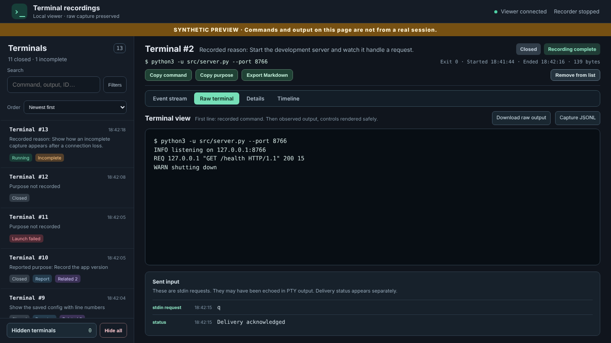
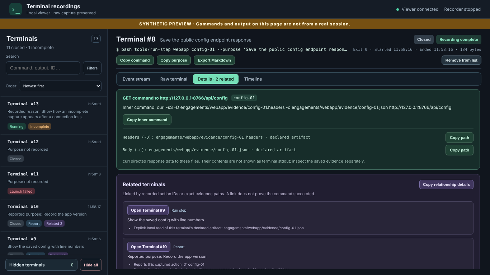

# Terminal Recorder for Codex CLI

Record every terminal command that [OpenAI Codex CLI](https://github.com/openai/codex)
runs, and watch it live in a local web viewer: the command, its output, input,
exit code and timing, one tab per process.

The launcher starts a **new** Codex session whose command executor (`codex
exec-server`) is reached through a small recording proxy. The proxy saves each
event to `events.jsonl` before passing it on, and a read-only viewer on
`127.0.0.1` shows it. Pure Python standard library; nothing to build or install.



```
codex ──> proxy.py ──> codex exec-server
             │
             ▼
        events.jsonl ──> viewer (127.0.0.1) ──> browser
```

## Requirements

- Linux, or Windows with WSL (macOS is untested)
- Python 3.9+
- Codex CLI, logged in (tested with 0.163.0)
- A non-root user account

## Quick start

```bash
npm install -g @openai/codex && codex login     # if Codex is not installed yet

git clone https://github.com/tahsinunluturk/terminal-recorder-for-codex-cli.git
cd terminal-recorder-for-codex-cli
./start-recorded-codex --check                  # checks the setup, starts nothing
./start-recorded-codex                          # starts a recorded Codex session
```

Before Codex opens, the launcher prints the viewer address:

```
Live viewer: http://127.0.0.1:41873/
```

Open it in a browser and use Codex as usual. When you quit Codex, the recorder
and viewer stop and the capture stays on disk. Useful options:

```bash
./start-recorded-codex --viewer-port 8765       # fixed port instead of a random one
./start-recorded-codex -- "explain this repo"   # arguments after -- go to codex
```

Codex's `exec-server` is still marked experimental, so run `--check` again
after upgrading Codex.

## Try the viewer without Codex

```bash
python3 demo/make_demo.py /tmp/recorder-demo
python3 ui/server.py --capture-dir /tmp/recorder-demo --port 8765 --demo
```

Open `http://127.0.0.1:8765/`. The demo commands are sample data and are
never run.

## Past sessions

Captures are saved under `~/.local/state/terminal-recorder-for-codex-cli/`
(set `CODEX_TERMINAL_RECORDER_DIR` to change this). To view or check one:

```bash
python3 ui/server.py --capture-dir ~/.local/state/terminal-recorder-for-codex-cli/SESSION --port 8765
python3 audit.py ~/.local/state/terminal-recorder-for-codex-cli/SESSION
```

`audit.py` checks the journal for gaps and hash mismatches. Its best result is
`PARTIAL`, because a capture cannot prove that every Codex action went through
the recorder.

**Remote machine:** the viewer listens only on `127.0.0.1`. Start it with
`--viewer-port 8765` and forward the port: `ssh -L 8765:127.0.0.1:8765 user@host`.

## The viewer

- Status for each terminal: Running, Closed, exit code, Launch failed or
  Incomplete recording
- Event stream, raw terminal view, details and a timeline of parallel commands
- Search in commands and output, status filters
- Copy the command, export to Markdown with a SHA-256 of the output, download
  raw bytes
- Notes and hiding, stored separately; `events.jsonl` is never changed

Everything is shown from the recorded data using fixed rules. No AI model is
involved and the page loads nothing from the internet.

## What is not recorded

Only commands Codex runs through this session's exec-server are recorded. Not
included: Codex sessions started some other way, file edits Codex makes
directly (such as applying a patch), web requests, the model conversation, and
files a command writes without printing (such as `curl -o file`).

## Privacy

Captures contain everything commands print and everything typed into them,
including passwords. They are saved with private (`0600`) permissions. Do not
commit or share them. The servers listen only on `127.0.0.1`.

## Step wrappers (optional)

The exec-server does not say *why* a command ran. If you want a purpose shown
for each command and related commands linked together, have Codex run commands
through small wrapper scripts:

```bash
bash tools/run-step webapp health-01 --purpose "Save the health endpoint response" -- curl ...
```

Ready-made wrappers and instructions for Codex are included. One command adds
them to your project:

```bash
examples/step-wrappers/install.sh ~/my-project
```

It creates `tools/` with the wrappers, an `engagements/<name>/evidence/` folder
for saved files, and adds instructions to the project's `AGENTS.md` so Codex
uses them. Nothing existing is overwritten. For commands run this way the
viewer also shows:

- the purpose under each terminal
- the real command, and for `curl` the URL and the files it saved
- **Related terminals**: links between a step, later steps that read its saved
  files, and the report that cites it
- an **Engagement** filter, and search by step ID

Add `engagements/` to your `.gitignore`, because saved files can contain
secrets.



## Tests

```bash
python3 -m unittest test_audit test_launcher test_proxy test_real_codex test_step_wrappers
(cd ui && python3 -m unittest test_ui)
for t in ui/test_*.js; do node "$t"; done       # needs Node.js
```

No test calls a model. `test_real_codex` is skipped when Codex is not installed.

## License

[MIT](LICENSE)
